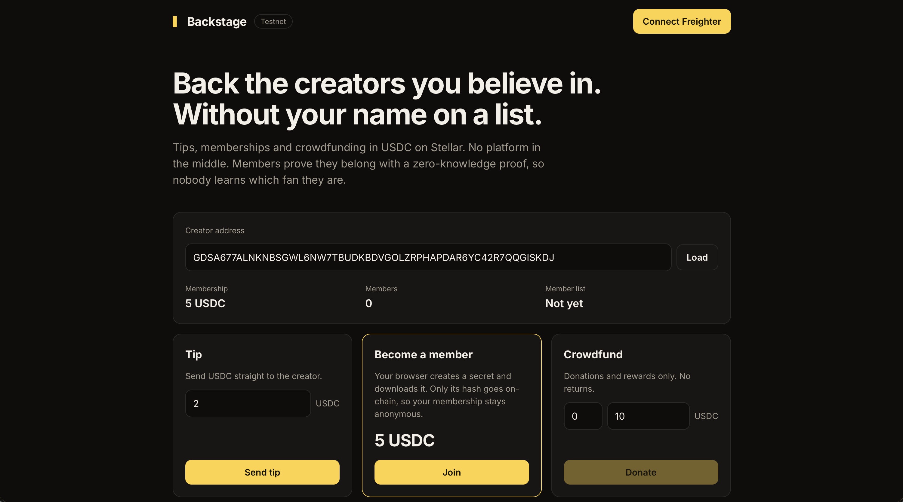

# Backstage

Private fan support for creators on Stellar. Fans pay in USDC. Creators keep their income without a platform in the middle.

## What is in this repo

contracts/backstage is a Soroban contract with four parts.

- Open tips. A fan sends USDC to a creator.
- Memberships. A fan pays the membership price and registers an identity commitment, Poseidon(secret). The commitment says nothing about who the fan is.
- Private membership proofs. A fan proves they are a member without revealing which one. The proof is Groth16 over BN254 and the contract verifies it with Stellar's native BN254 host functions (CAP-0074, Protocol 25+). A nullifier stops the same member acting twice in one scope.
- Crowdfunding. Donations and rewards only. Money goes straight to the creator. No refunds, no returns.

circuits/membership.circom is the membership circuit. Poseidon Merkle tree, depth 16.

## Not in this version

- Hidden tip amounts and hidden senders. The plan is Confidential Tokens.
- The join payment is a public USDC transfer. A fan who wants full privacy pays from a fresh wallet.
- The creator computes the Merkle root off-chain and posts it with set_members_root. Recomputing it on-chain with the Poseidon permutation host functions (CAP-0075) comes later.
- The Groth16 setup below is a single-contributor dev setup. Production needs a real ceremony.

## Build and test the contract

    cargo test
    stellar contract build

## Build the circuit

    npm install circomlib snarkjs
    mkdir -p circuits/build
    circom circuits/membership.circom --r1cs --wasm -o circuits/build
    snarkjs powersoftau new bn128 15 pot_0000.ptau
    snarkjs powersoftau contribute pot_0000.ptau pot_0001.ptau --name="dev" -e="random"
    snarkjs powersoftau prepare phase2 pot_0001.ptau pot_final.ptau
    snarkjs groth16 setup circuits/build/membership.r1cs pot_final.ptau membership.zkey
    snarkjs zkey export verificationkey membership.zkey verification_key.json

verification_key.json becomes the constructor argument vk. You can deploy with a placeholder key first and swap in the real one later with set_vk. Encode each point uncompressed big-endian (Ethereum format, per the soroban-sdk 29 docs). G1 is 64 bytes: x || y. G2 is 128 bytes: x.c1 || x.c0 || y.c1 || y.c0. snarkjs writes each G2 coordinate as [c0, c1], so swap the two halves. Drop the third coordinate snarkjs adds to every point (it is always 1).

## Deploy to testnet

Live on testnet: CDP3UFFH6PG5BICR4VKRTVG4LULNLOSLQYJ5KAZ2NRO536HH5SC7JXVR
https://stellar.expert/explorer/testnet/contract/CDP3UFFH6PG5BICR4VKRTVG4LULNLOSLQYJ5KAZ2NRO536HH5SC7JXVR

First creator registered: https://stellar.expert/explorer/testnet/tx/cb166f0aeb7a60a4a2fbd5437b0b0c7a88dcc815e3b7ab3e5755b68281692d8f

    stellar keys generate creator --network testnet --fund
    stellar contract deploy \
      --wasm target/wasm32v1-none/release/backstage.wasm \
      --source creator --network testnet \
      -- --admin creator --usdc <USDC_CONTRACT_ID> --vk "$(cat vk.json)"

## Flow

1. Creator calls register_creator with a monthly price.
2. Fan generates a secret locally and calls join with Poseidon(secret).
3. Creator rebuilds the member tree from the Joined events and calls set_members_root.
4. Fan builds a proof locally and calls prove_membership with a scope, for example a post id.
5. The contract checks the proof, stores the nullifier and emits MemberVerified. The frontend unlocks the content.
